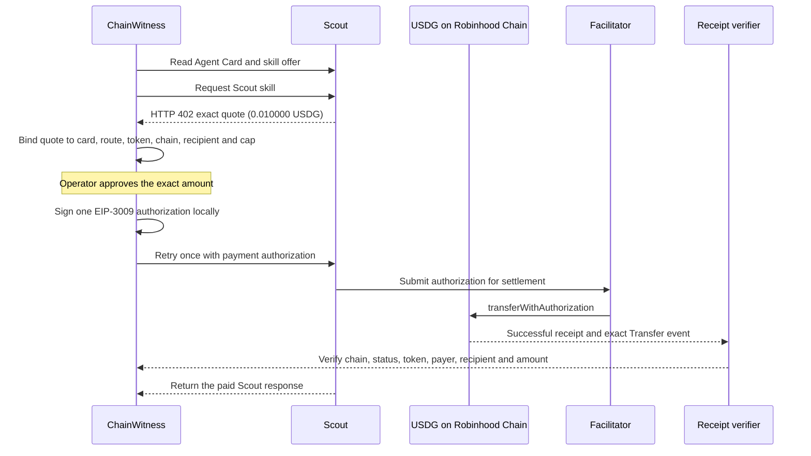

# Reviewer walkthrough

## The result in one sentence

ChainWitness made one live x402 call to Scout, paid exactly **0.010000 USDG** on Robinhood Chain through EIP-3009, and verified the resulting transfer from the public chain receipt.

- [Open the transaction on Blockscout](https://robinhoodchain.blockscout.com/tx/0x9bf2ef3529a35c3ee2c3e15fc548483e1b00bfa0a30231250153d6dec8f4fee9)
- [Full paid-call evidence record](PAID_CALL_PROOF.md)
- [Source repository](https://github.com/ulegend01/ChainWitness)

## Review it without a wallet or private key

Clone the public repository and run:

```powershell
npm ci
npm run verify-receipt -- --hash 0x9bf2ef3529a35c3ee2c3e15fc548483e1b00bfa0a30231250153d6dec8f4fee9 --from 0x43dfaF755D818884D2D9D065255aA2458999fDcA --to 0x0a64498810C29C3Ac3b9557940b70A095dc745D9 --amount-usdg 0.01
```

The verifier checks the configured Robinhood Chain ID, transaction status, USDG contract and matching `Transfer` event for the expected payer, recipient and amount. It does not request a private key or submit a transaction.

For a broader local check, the repository's CI runs `npm test` and `npm audit --omit=dev --audit-level=high`.

## What happened in the paid call



The facilitator submitted the settlement transaction and paid gas. The test payer did not need ETH. The transaction's USDG transfer is 10,000 base units, equal to 0.010000 USDG.

## Why the safety gates matter

- The client checks the live offer against the HTTP 402 quote before signing.
- It allows the exact EIP-3009 scheme and exact quoted amount, under a hard cap.
- It requires an interactive operator confirmation before creating the authorization.
- It treats a failure after signing as an uncertain settlement and does not blindly retry.
- It verifies the chain receipt instead of trusting a success-shaped HTTP response.

## Scope of the evidence

The transaction proves that this specific payment settled successfully. It does **not** prove that Scout's research or grading is correct, nor does it guarantee future facilitator behavior. The repository separates paid-call evidence from simulated demo output; `npm run demo` is explicitly a simulation and is not payment evidence.

## Reproduce the demo safely

Use the receipt-verification command above for the live transaction. It is read-only. Do not run `npm run scout-once -- --yes-pay-real-money` just to review the project: that command initiates another real payment.
